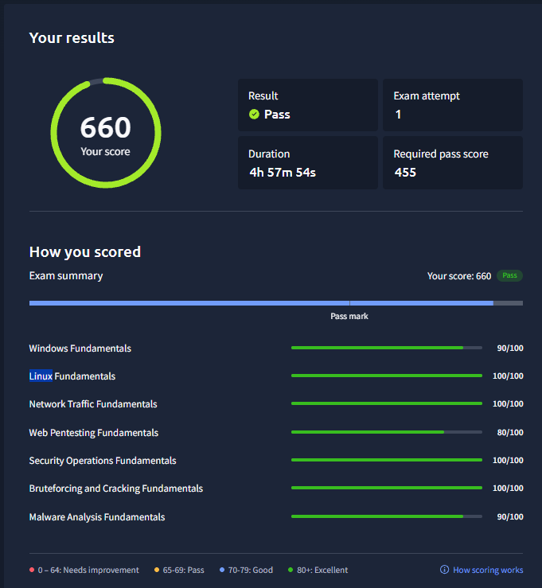

# 🛡️ TryHackMe — Cyber Security 101 (SEC1)

**Certificação profissional obtida por exame prático**

**🏆 Aprovado na primeira tentativa — 660/700 pontos (94,3%)**

**📄 [Ver certificado oficial emitido pela TryHackMe](https://assets.tryhackme.com/certification-certificate/6aedfa7a16a2c59cb259fa96.pdf)**

## Informações da certificação

- **Instituição:** TryHackMe
- **Certificação:** Cyber Security 101 (SEC1)
- **Emissão:** 06/11/2026
- **Pontuação mínima:** 455/700
- **Duração do exame:** 4h57min54s
- **Tentativas:** 1

## Competências avaliadas

Fundamentos de Windows e Linux, análise de tráfego de rede, testes de segurança em aplicações web, operações de segurança, auditoria de senhas e análise básica de malware.

A imagem acima apresenta a pontuação detalhada nos sete módulos do exame.

[← Voltar às certificações profissionais](README.md)
